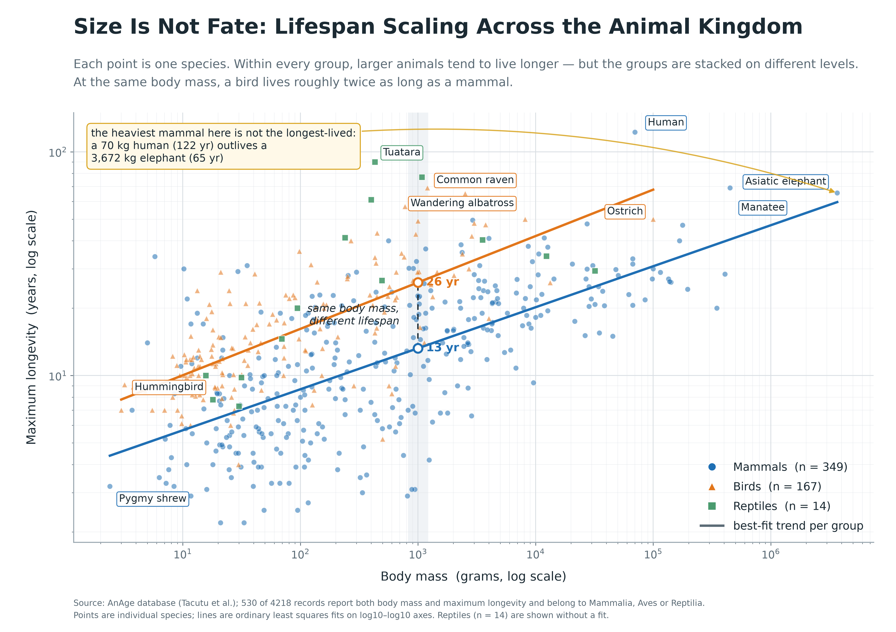
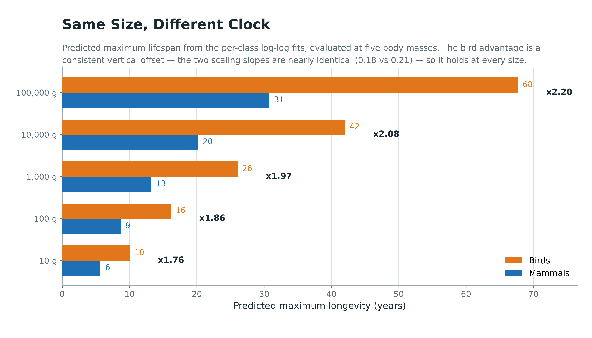

# Does body size buy longevity? — A scaling analysis of the AnAge database

A data-science project on how **maximum lifespan scales with body mass across animal classes**.



## The question

Across species, does a bigger body mean a longer life — and if so, does the same rule hold for
mammals, birds and reptiles? The analysis asks two things:

1. Within each class, how strongly does maximum longevity scale with body mass?
2. At an **identical body mass**, do the classes differ in expected lifespan?

The short answer: within a class, yes — mass buys lifespan with a consistent elasticity. Between
classes, the rule resets to a different level. At 1 kg, the fitted model predicts **13.2 years for a
mammal and 26.1 years for a bird** (×1.97), even though the two scaling slopes are nearly identical
(0.183 vs 0.207).

## Dataset

**Source:** [AnAge database](https://genomics.senescence.info/species/) (Human Ageing Genomic
Resources) — a curated compilation of longevity and life-history traits of vertebrates.

- Raw extract used here: `anage_data.csv`, **4,218 records**
- Filter applied: keep records of `Mammalia`, `Aves`, `Reptilia` that report **both** `Body mass (g)`
  and `Maximum longevity (yrs)` → **530 species** (mammals 349, birds 167, reptiles 14)
- 3,688 raw records were dropped because one of the two fields is missing

**Usage permissions:** the dataset is **not redistributed in this repository**. Download it from
AnAge and follow the terms of use published there; please cite the AnAge release
(Tacutu et al., *Nucleic Acids Research*) whenever the data or these results are reused.
No personal, confidential or restricted data is contained in this repository.

## Methods and tools

| Step | Detail |
|---|---|
| Cleaning | drop rows missing body mass or maximum longevity; restrict to the three classes |
| Transform | log10 of both body mass and longevity (both span several orders of magnitude) |
| Model | ordinary least squares per class: `log10(longevity) = a + b · log10(mass)` |
| Comparison | evaluate each fitted line at the same body masses (10 g … 100 kg) to isolate class from size |
| Figures | matplotlib 3.11 (300 dpi PNG), colour-blind-safe palette, per-class marker shapes |
| Language | Python 3.14, pandas 3.0, numpy 2.4 |

Reptiles (n = 14) are plotted but deliberately **not** fitted — a stable slope cannot be estimated
from fourteen records, and drawing a confident line through them would overstate the evidence.

## Key findings

| Class | n | Slope (log–log) | r | Predicted lifespan at 1 kg |
|---|---|---|---|---|
| Mammalia | 349 | 0.183 | 0.663 | 13.2 yr |
| Aves | 167 | 0.207 | 0.713 | 26.1 yr |
| Reptilia | 14 | 0.231 | 0.655 | 32.5 yr (indicative only — no fit drawn) |

- **Within a class**, a tenfold increase in body mass predicts roughly a **1.5-fold** increase in
  maximum longevity (10^0.183 ≈ 1.52 for mammals, 10^0.207 ≈ 1.61 for birds).
- **Between classes**, the slopes are nearly parallel but the intercepts are not: the bird line sits
  about a factor of two above the mammal line at every size (×1.76 at 10 g → ×2.20 at 100 kg).
- The exceptions carry the argument: a 70 kg human (122 yr) outlives a 3,672 kg Asiatic elephant
  (65 yr), and a 3 g hummingbird lives about three times as long as a 2.4 g pygmy shrew.



## Limitation

AnAge records **maximum** longevity, largely for animals held in zoos and laboratories, not life
expectancy in the wild. Captivity removes predation, infection and starvation, which inflates the
recorded ages and probably flatters large-bodied species that are expensive but feasible to keep.
The strict two-field filter may also drop poorly studied taxa, so the sample is biased towards
well-documented vertebrates. The chart therefore describes how *potential* lifespan scales under
protection — not how long these animals live in nature.

## Repository layout

```
data-science-project/
├── anage_analysis.py              # full pipeline: cleaning → fits → both figures → results/fits.json
├── requirements.txt
├── data/
│   └── README.md                  # how to obtain anage_data.csv (not redistributed)
├── figures/
│   ├── main_mass_vs_longevity.png
│   └── class_scaling_summary.png
└── results/
    └── fits.json                  # every number quoted above, regenerated by the script
```

## How to run

```bash
# 1. dataset (not in this repo) — download the AnAge species export and save it as:
#    data/anage_data.csv   ...or pass any path with --data
# 2. environment
python -m venv .venv && . .venv/bin/activate     # Windows: .venv\Scripts\activate
pip install -r requirements.txt
# 3. analysis (writes figures/ and results/fits.json)
python anage_analysis.py                          # uses data/anage_data.csv by default
python anage_analysis.py --data /path/to/anage_data.csv --out figures
```

Expected console output (reproduced 2026-10):

```
records: 4218 raw, 530 used, 3688 dropped (missing mass or longevity)
  Mammalia  n=349  slope=+0.183  r=+0.663  predicted@1kg= 13.2 yr
  Aves      n=167  slope=+0.207  r=+0.713  predicted@1kg= 26.1 yr
  Reptilia  n=14   slope=+0.231  r=+0.655  predicted@1kg= 32.5 yr
figures: main_mass_vs_longevity.png | class_scaling_summary.png
```

Figures are deterministic (no sampling, no random state); re-running reproduces the same PNGs.

## Context

Written for **CISC7204 Data Science and Data Visualization** (University of Macau, 2026/27),
extended from the Practice 07 visualization exercise "Draw Me a Visualization" into a reproducible
project: the original figure, plus a companion chart, plus the analysis script that regenerates
both and the underlying statistics.
